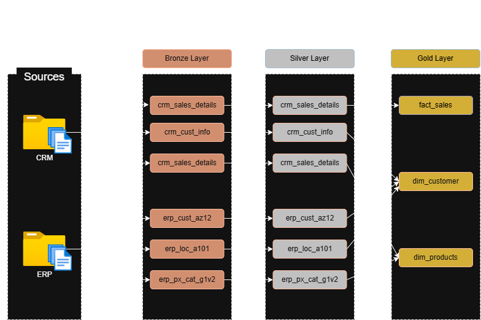
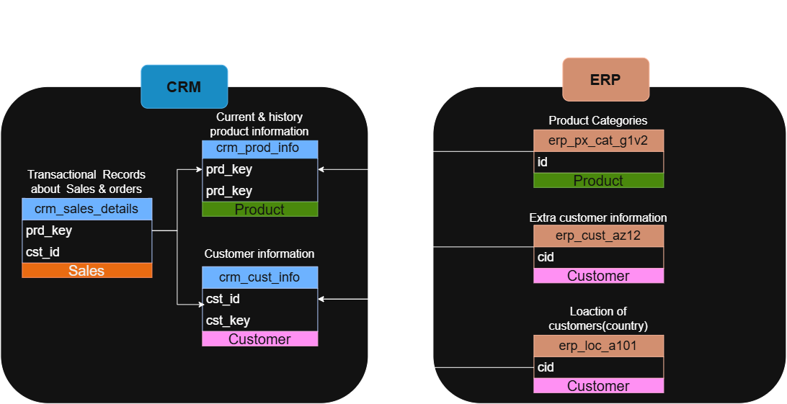
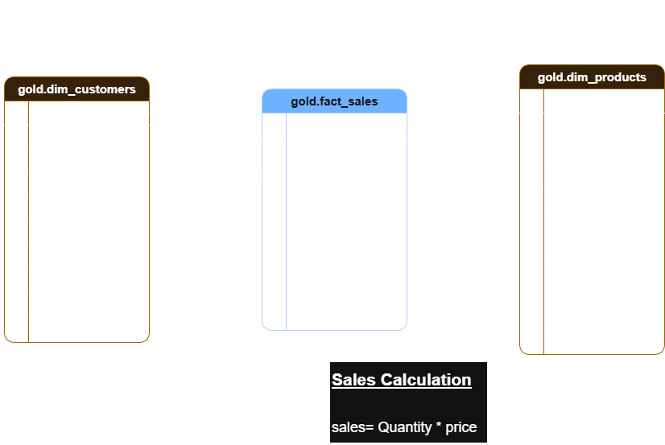

# 🚀 Data Warehouse Project
### End-to-End Data Engineering

  
  
  

---

## 👋 Welcome to the Project

This repository showcases the **end-to-end development of a modern data warehouse**, transforming raw data from **ERP** and **CRM** source systems into clean, integrated, and analytics-ready datasets.

Built with **SQL Server** and the **Medallion Architecture** 🥉🥈🥇, the project explores practical data engineering concepts including ETL pipeline development, data quality management, source-system integration, and dimensional modeling.

🎯 **Project goal:** transform fragmented operational data into a reliable foundation for analytical reporting and data-driven business decisions.

---

## 📖 Project Overview

The project brings together four core areas of data engineering:

| Area | What it covers |
|---|---|
| 🏗️ **Data Architecture** | Organizing the warehouse into Bronze, Silver, and Gold layers. |
| 🔄 **ETL Pipelines** | Loading source CSV files and transforming data for downstream use. |
| 🧩 **Data Modeling** | Designing fact and dimension tables for analytical queries. |
| 📊 **Analytics & Reporting** | Preparing structured data for SQL-based reporting and business insights. |

This project is relevant to people exploring **SQL development, data engineering, ETL development, data architecture, data modeling, and data analytics**.

---

## 🎯 Project Requirements

### Objective

Develop a modern SQL Server data warehouse that consolidates sales data from ERP and CRM source systems to support analytical reporting and informed decision-making.

### Scope & Specifications

- **Data sources:** Import CSV datasets from two source systems — ERP and CRM.
- **Data quality:** Identify and resolve data quality issues before analysis.
- **Integration:** Combine relevant information from both systems into a consistent, analytics-friendly data model.
- **Data modeling:** Structure business-ready data into fact and dimension tables.
- **Scope boundary:** Focus on the latest available dataset; historical tracking and historization are not required.
- **Documentation:** Document the architecture and data model to support technical teams and business stakeholders.

---

## 🏗️ Data Architecture

### From Raw Source Files to Analytics-Ready Data

The warehouse follows the **Medallion Architecture**, progressively refining data through Bronze, Silver, and Gold layers.

  
   
  <b>Figure 1.</b> High-level architecture and data flow across the warehouse layers.

### 🥉 Bronze Layer — Raw Data

> **Purpose: preserve source data as received.**

- 📥 Ingest ERP and CRM CSV files into SQL Server raw tables.
- 🗄️ Keep source records available before applying business transformations.
- 🔍 Separate ingestion logic from downstream cleansing and modeling.

### 🥈 Silver Layer — Cleaned & Standardized Data

> **Purpose: improve data quality and consistency.**

- 🧹 Cleanse and standardize data types, formats, and values.
- ✅ Address missing values, duplicates, and inconsistent records where applicable.
- 🔗 Integrate related entities from ERP and CRM.
- 🛠️ Prepare consistent datasets for analytical modeling.

### 🥇 Gold Layer — Business-Ready Data

> **Purpose: make data straightforward to query for analytics.**

- ⭐ Model integrated data into fact and dimension tables.
- 📐 Apply relevant business rules and prepare measures and descriptive attributes.
- 📊 Provide a stable foundation for SQL analysis and reporting.

---

## 🔄 End-to-End Data Flow

### Following Data from Source to Gold

The data flow diagram shows how data from the **CRM and ERP source systems** moves through each Medallion layer. It highlights the table-level progression from raw ingestion in Bronze, through cleansing and standardization in Silver, to the business-ready fact and dimension tables in Gold.

  
   
  <b>Figure 2.</b> Table-level data flow from source systems through Bronze and Silver into the Gold layer.

### 🧭 How to Read the Diagram

- **📁 Sources — ERP & CRM:** CSV files provide the raw customer, product, category, and sales-related data.
- **🥉 Bronze — Raw Ingestion:** Source records are loaded into raw tables, keeping ingestion separate from downstream transformations.
- **🥈 Silver — Cleansed & Standardized:** Data is cleaned and made more consistent before it is combined for analytics.
- **🥇 Gold — Business-Ready Model:** The transformed data feeds the sales fact table and customer and product dimensions for analytical queries.

**Why it matters:** Separating these stages makes the pipeline easier to reason about, troubleshoot, and maintain, while giving each layer a clear responsibility.

---

## 🔗 Source-System Integration

ERP and CRM systems can store related information in different structures. The integration model illustrates the relationships between source entities and how relevant product, customer, and sales information can be connected for the warehouse.

  
   
  <b>Figure 3.</b> Source-system integration model for ERP and CRM entities.

---

## ⭐ Data Modeling — Sales Data Mart

The Gold layer is designed for analytical queries using a **star schema**. The sales fact table stores measurable sales activity and connects to descriptive dimensions, such as customers and products.

  
   
  <b>Figure 4.</b> Sales data mart star schema with a sales fact table and related dimensions.

### 🧱 Model at a Glance

- **`gold.fact_sales`** — central fact table for sales measures and related dimension keys.
- **`gold.dim_customers`** — descriptive customer attributes for customer-level analysis.
- **`gold.dim_products`** — product attributes for product and category analysis.
- **Star schema** — simplifies analytical joins and supports reporting across business dimensions.

*The final schema and column definitions should reflect the implemented SQL tables and source datasets.*

---

## 🔄 End-to-End Workflow Summary

1. **📁 Source:** ERP and CRM CSV files.
2. **🥉 Bronze:** Raw data ingestion into SQL Server.
3. **🥈 Silver:** Cleansing, standardization, and integration.
4. **🥇 Gold:** Fact and dimension modeling for analytics.
5. **📊 Consumption:** SQL queries and reporting on business-ready data.

---

## 🛠️ Technology Stack

| Technology | Role |
|---|---|
| **SQL Server Express** | Database engine for the warehouse |
| **SQL** | Data loading, transformation, validation, and analytical queries |
| **SQL Server Management Studio (SSMS)** | Database development and administration |
| **CSV** | ERP and CRM source data format |
| **Draw.io** | Architecture and data-model diagrams |
| **Git & GitHub** | Version control and project documentation |

---

## 📌 Project Scope Notes

- The solution focuses on the latest available dataset.
- Historical change tracking and historization are outside the current scope.
- Reporting is supported through SQL-based analytical queries; additional BI or machine-learning integrations are not implied unless implemented separately.

---

🛠️ **Core Focus:** SQL Server · ETL · Data Quality · Data Integration · Dimensional Modeling

